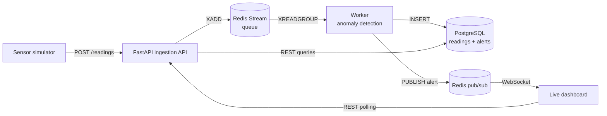

# Sensor Monitor

A real-time monitoring backend. Simulated sensors send readings to an API, the readings wait in a queue, a worker checks each one for anomalies (sudden spikes, frozen sensors), stores the results in PostgreSQL, and pushes alerts to a live dashboard the moment they happen.

The whole system starts with one command and survives a worker crash without losing data.

## Architecture



| Part | Job |
|---|---|
| `simulator/` | Pretends to be sensors; occasionally injects spikes and frozen readings |
| `app/main.py` | API: validates readings, enqueues them, serves queries, WebSocket and dashboard |
| Redis Stream | The queue between the API and the worker |
| `app/worker.py` | Takes readings from the queue, runs detection, stores results, publishes alerts |
| `app/detection.py` | Anomaly rules (no I/O, easy to test and extend) |
| PostgreSQL | Permanent storage for readings and alerts |
| `app/static/index.html` | Dashboard: sensor status board, queue backlog, live alert feed |

## Quick start

Requires [Docker Desktop](https://www.docker.com/products/docker-desktop/).

```bash
docker compose up --build
```

Open <http://localhost:8000>. Within a few seconds you should see sensors appear and, soon after, alerts.
Interactive API docs: <http://localhost:8000/docs>.

Stop with `Ctrl+C`; remove everything including stored data with `docker compose down -v`.

## See the queue work

The dashboard shows how many readings are waiting in the queue. To make that visible, slow the worker down and flood the system:

```bash
# 1. restart the worker with an artificial pause after each batch of 100 readings
WORKER_DELAY_SECONDS=0.5 docker compose up -d worker      # Windows PowerShell: $env:WORKER_DELAY_SECONDS=0.5; docker compose up -d worker

# 2. send 3000 readings at once
docker compose run --rm simulator python simulator/simulate.py --url http://api:8000/readings --burst 3000
```

The API answers instantly while the backlog climbs, then drains as the worker catches up. Nothing is lost. Afterwards, restore normal speed with `docker compose up -d worker` in a fresh terminal (where the variable is not set).

Then try breaking it: `docker compose kill worker`, wait a few seconds, `docker compose up -d worker`. The worker resumes from the queue.

## Run the tests

```bash
python -m venv venv
venv\Scripts\activate            # Mac/Linux: source venv/bin/activate
pip install -r requirements-dev.txt
python -m pytest
```

The tests need no Redis or database: the detection logic is pure Python and the API tests use a fake queue.

## API

| Method and path | Purpose |
|---|---|
| `POST /readings` | Submit `{"sensor_id": "temp-1", "timestamp": "2026-01-01T10:00:00Z", "value": 71.5}`. Returns `202 Accepted`, or `422` if invalid |
| `GET /sensors` | Latest value per sensor and its alert count over the last 5 minutes |
| `GET /sensors/{id}/readings?limit=100` | Recent history of one sensor |
| `GET /alerts?limit=50` | Most recent alerts |
| `GET /stats` | Queue backlog and total alert count |
| `WS /ws/alerts` | Live stream of alerts as JSON |

## Design decisions

- **Queue between API and worker.** Ingestion stays fast no matter how slow processing is, and bursts are absorbed instead of dropped.
- **Acknowledge after storing.** The worker confirms a message only after it is saved. A crash leaves unconfirmed messages in the queue, and the worker re-reads them on restart (at-least-once delivery).
- **Idempotent writes.** `UNIQUE` constraints plus `ON CONFLICT DO NOTHING` make reprocessing a message harmless.
- **Batching.** The worker reads and inserts up to 100 readings at a time instead of one by one.
- **Detection separated from I/O.** `detection.py` has no dependencies on Redis or Postgres, so it is unit tested directly.
- **Spike threshold of 4 standard deviations**, not the textbook 3: with 3, ordinary noise causes a false alarm about once per 370 readings per sensor.
- **Alerts pushed over WebSocket** using Redis pub/sub, so several API instances can all serve the same live feed.

## Known limitations

- The detector keeps its recent-values window in memory, so a worker restart briefly "forgets" history (it needs 10 new readings per sensor before spike detection resumes).
- One worker is assumed. Several workers would each need their own detector state, or readings would need to be routed per sensor.
- The API has no authentication, so do not expose it publicly with real data without adding an API key.
- The queue is capped at roughly 100,000 entries; a backlog larger than that would lose the oldest unread readings.
- No data retention policy: the readings table grows forever.

## Deploying

Any machine that runs Docker can run this with the same command (`docker compose up -d --build`), for example a small rented virtual server. Before exposing it to the internet:

1. Change the database password in `docker-compose.yml`.
2. Put it behind an HTTPS reverse proxy (the dashboard automatically switches to `wss://` on HTTPS).
3. Add authentication to `POST /readings`.
